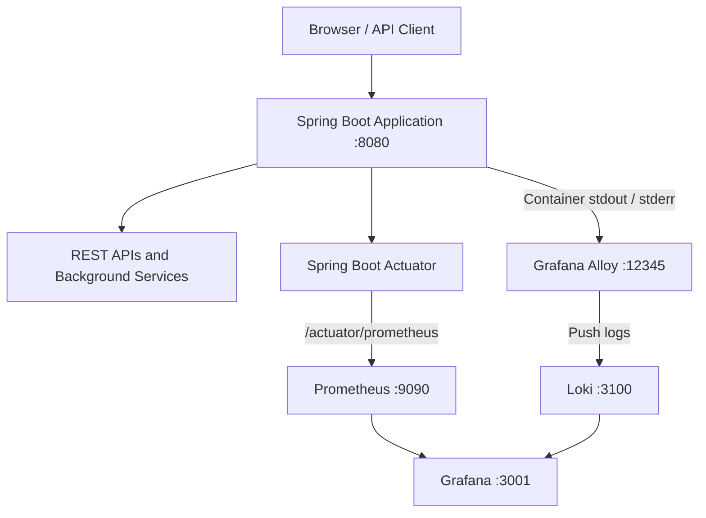

# Spring Boot Observability Stack

A Docker-based application observability project built using **Java 21, Spring Boot, Spring Boot Actuator, Micrometer, Prometheus, Grafana, Loki, and Grafana Alloy**.

The project demonstrates how to build, containerize, monitor, and observe a Spring Boot application using a consolidated observability stack. It includes REST APIs, scheduled background services, custom application metrics, centralized logging, and interactive Grafana dashboards.

---

## Project Status

### Completed

- [x] Created the Spring Boot application using Java 21.
- [x] Configured Spring Boot Actuator and Micrometer.
- [x] Implemented application REST endpoints.
- [x] Implemented Weather API integration using Open-Meteo.
- [x] Implemented Exchange Rate API integration using Frankfurter.
- [x] Implemented the Heartbeat Generator.
- [x] Implemented the Date & Unique Number Generator.
- [x] Added scheduled background execution for the application services.
- [x] Added custom Micrometer counters for background-service monitoring.
- [x] Configured Prometheus to scrape application metrics.
- [x] Configured Grafana dashboards for application and service monitoring.
- [x] Configured Loki for centralized log storage.
- [x] Configured Grafana Alloy for Docker container log collection.
- [x] Created a consolidated Spring Boot Observability Overview dashboard.
- [x] Containerized the application and monitoring services using Docker.
- [x] Started all five Docker containers successfully.
- [x] Verified application metrics through the Prometheus endpoint.

### Next milestone

- [ ] Prepare the application for Kubernetes deployment.
- [ ] Create Kubernetes Deployment and Service manifests.
- [ ] Configure application and monitoring service deployment.
- [ ] Verify the observability stack in a Kubernetes environment.

---

## 1. Architecture

The project follows a containerized observability architecture. The Spring Boot application generates application metrics and logs. Prometheus collects metrics, Alloy collects container logs, and Loki stores those logs. Grafana provides a centralized interface for monitoring both metrics and logs.



### Architecture components

| Component | Responsibility | Local address |
|---|---|---|
| Spring Boot | Runs REST APIs and background services | http://localhost:8080 |
| Spring Boot Actuator | Exposes application health and metrics | `/actuator/health`, `/actuator/metrics`, `/actuator/prometheus` |
| Prometheus | Collects and stores application metrics | http://localhost:9090 |
| Grafana Alloy | Collects Docker container logs | http://localhost:12345 |
| Loki | Stores and queries application logs | http://localhost:3100 |
| Grafana | Visualizes metrics and logs | http://localhost:3001 |

**Note:** Grafana uses host port `3001` because port `3000` was already occupied by another Grafana installation on the Windows host.

---

## 2. Technology Stack

| Technology | Purpose |
|---|---|
| Java 21 | Application runtime |
| Spring Boot | Application framework and REST API development |
| Maven | Dependency management and project build |
| Spring Boot Actuator | Application health and operational endpoints |
| Micrometer | Application metrics instrumentation |
| Prometheus | Metrics collection and storage |
| Grafana | Monitoring dashboards and visualization |
| Loki | Centralized log storage |
| Grafana Alloy | Docker container log collection and forwarding |
| Docker | Application containerization |
| Docker Compose | Multi-container orchestration |

The Dockerfile uses a multi-stage build. Maven with Eclipse Temurin 21 builds the application JAR, and a Java 21 runtime image executes the application.

---

## 3. Project Structure

The project follows a modular Spring Boot application structure.

```text
Springboot-observability/
│
├── src/
│   └── main/
│       ├── java/
│       │   └── com/angamba/observability/
│       │       │
│       │       ├── ObservabilityApplication.java
│       │       │
│       │       ├── Controller/
│       │       │   ├── WeatherController.java
│       │       │   ├── ExchangeController.java
│       │       │   ├── HeartbeatController.java
│       │       │   └── DateGeneratorController.java
│       │       │
│       │       ├── Service/
│       │       │   ├── WeatherService.java
│       │       │   ├── ExchangeService.java
│       │       │   ├── HeartbeatService.java
│       │       │   └── DateGeneratorService.java
│       │       │
│       │       └── Scheduler/
│       │           ├── WeatherScheduler.java
│       │           ├── ExchangeScheduler.java
│       │           ├── HeartbeatScheduler.java
│       │           └── DateGeneratorScheduler.java
│       │
│       └── resources/
│           └── application.yaml
│
├── prometheus/
│   └── prometheus.yml
│
├── loki/
│   └── loki-config.yml
│
├── alloy/
│   └── config.alloy
│
├── grafana/
│   └── provisioning/
│       └── datasources/
│           └── datasources.yml
│
├── Dockerfile
├── .dockerignore
├── docker-compose.yml
├── pom.xml
├── mvnw
├── mvnw.cmd
└── README.md
```

The structure above describes the main application modules. Keep the filenames and paths consistent with the actual repository when adding or changing files.

---

## 4. Application Features

### 4.1 Weather API Integration

The application integrates with the Open-Meteo API to retrieve current weather information.

**Features:**

- City-based weather lookup.
- Automatic city-coordinate retrieval through Open-Meteo Geocoding.
- Current temperature.
- Feels-like temperature.
- Relative humidity.
- Wind speed.
- Weather code.
- Latest successful response caching.
- Scheduled weather refresh.
- On-demand weather requests.
- Error handling when the weather provider is unavailable.

**Scheduled execution:**

The weather scheduler refreshes weather data every 60 seconds by default.

Default city: `Guwahati`

Configuration:

```yaml
app:
  schedulers:
    weather:
      city: "Guwahati"
      fixed-delay: 60000
```

**API integration:**  
https://open-meteo.com/

### 4.2 Exchange Rate API Integration

The application integrates with the Frankfurter API to retrieve currency exchange rates.

**Features:**

- Base currency configuration.
- Target currency configuration.
- Current exchange-rate retrieval.
- Latest successful exchange-rate caching.
- Scheduled refresh.
- On-demand requests.
- Error handling for provider failures.

Default configuration:

```yaml
app:
  schedulers:
    exchange:
      base: "USD"
      target: "INR"
      fixed-delay: 60000
```

The scheduler refreshes exchange-rate data every 60 seconds by default.

**API integration:**  
https://www.frankfurter.dev/

### 4.3 Heartbeat Generator

The Heartbeat Generator produces periodic heartbeat events to demonstrate background-service execution and monitoring.

**Features:**

- Automatic heartbeat generation every 2 seconds.
- Unique incremental sequence number.
- Timestamp generation.
- Service status tracking.
- Latest heartbeat retrieval.
- Total heartbeat count.
- On-demand heartbeat generation.
- Scheduled and on-demand execution tracking.
- Micrometer counter instrumentation.

Example heartbeat response:

```json
{
  "service": "heartbeat-generator",
  "sequence": 10,
  "source": "SCHEDULED",
  "timestamp": "2026-11-02T06:30:00Z",
  "status": "UP"
}
```

The timestamp above is an illustrative example.

### 4.4 Date & Unique Number Generator

This service generates date/time information and unique identifiers.

**Features:**

- Unique identifier generation using UUID.
- Date and timestamp generation.
- Incremental sequence tracking.
- Scheduled generation every 10 seconds.
- On-demand generation through REST API.
- Total generation count.
- Scheduled and on-demand execution tracking.
- Micrometer metric instrumentation.

The service distinguishes between scheduled and on-demand executions using a source label.

### 4.5 Background Scheduler Configuration

The application uses Spring's scheduling functionality to execute background tasks.

| Background service | Default interval | Purpose |
|---|---:|---|
| Weather Scheduler | 60 seconds | Refresh weather information |
| Exchange Scheduler | 60 seconds | Refresh exchange rates |
| Heartbeat Scheduler | 2 seconds | Generate heartbeat events |
| Date Generator Scheduler | 10 seconds | Generate date and unique-number records |

The scheduler intervals are configurable through `application.yaml`.

---

## 5. REST API Endpoints

The following endpoints are used by the application.

| Endpoint | Purpose |
|---|---|
| `/` | Application home endpoint |
| `/slow` | Simulates a slow HTTP request |
| `/api/weather` | Weather API request |
| `/api/exchange` | Exchange-rate API request |
| `/api/heartbeat` | Generate a heartbeat on demand |
| `/api/heartbeat/latest` | Retrieve the latest heartbeat |
| `/api/heartbeat/count` | Retrieve the heartbeat count |
| `/api/date-generator` | Generate date and unique-number information |
| `/api/date-generator/count` | Retrieve generation count |
| `/api/date-generator/metrics` | Retrieve generator metrics |
| `/api/date-generator/status` | Retrieve generator status |
| `/actuator/health` | Application health |
| `/actuator/metrics` | Available application metrics |
| `/actuator/prometheus` | Prometheus-formatted metrics |

For endpoints that require query parameters, use the parameter names defined by the corresponding controller.

### Useful local URLs

- Application: http://localhost:8080/
- Slow endpoint: http://localhost:8080/slow
- Weather API: http://localhost:8080/api/weather
- Exchange API: http://localhost:8080/api/exchange
- Heartbeat API: http://localhost:8080/api/heartbeat
- Date Generator: http://localhost:8080/api/date-generator
- Actuator Health: http://localhost:8080/actuator/health
- Actuator Metrics: http://localhost:8080/actuator/metrics
- Prometheus Metrics: http://localhost:8080/actuator/prometheus

---

## 6. Micrometer and Prometheus Metrics

Micrometer is used to instrument the application and expose metrics in Prometheus format.

Prometheus scrapes the Spring Boot application through:

```text
http://springboot-app:8080/actuator/prometheus
```

### 6.1 Prometheus Configuration

File: `prometheus/prometheus.yml`

```yaml
global:
  scrape_interval: 5s
  evaluation_interval: 5s

scrape_configs:
  - job_name: "springboot-app"
    metrics_path: "/actuator/prometheus"
    static_configs:
      - targets: ["springboot-app:8080"]
```

Prometheus uses the Compose service name `springboot-app` because containers communicate with each other through the Docker network.

### 6.2 Application and JVM Metrics

The application exposes standard Spring Boot and JVM metrics, including:

- Application scrape availability.
- Application uptime.
- Live JVM threads.
- JVM heap memory usage.
- JVM heap memory maximum.
- Process CPU usage.
- HTTP request count.
- HTTP request duration.

### 6.3 Custom Background-Service Metrics

Custom Micrometer counters have been added to the background services.

| Metric | Purpose |
|---|---|
| `heartbeat_generated_total` | Total heartbeat events generated |
| `heartbeat_service_up` | Heartbeat service availability gauge |
| `weather_refresh_total` | Successful weather refreshes |
| `weather_refresh_failures_total` | Failed weather refresh attempts |
| `exchange_refresh_total` | Successful exchange-rate refreshes |
| `exchange_refresh_failures_total` | Failed exchange-rate refresh attempts |
| `date_generator_records_generated_total` | Generated date and unique-number records |

The Weather, Exchange, Heartbeat, and Date Generator counters distinguish scheduled and on-demand activity through a `source` label.

Example:

```text
source="scheduled"
source="on_demand"
```

**Important:** The `heartbeat_service_up` gauge reports the service's registered availability value. For actual application scrape availability, use Prometheus's `up{job="springboot-app"}` metric.

---

## 7. Loki and Grafana Alloy – Centralized Logging

The project uses Loki and Grafana Alloy to collect and query application logs.

### Logging architecture

```text
Spring Boot Application
        |
        | Container stdout / stderr
        v
Grafana Alloy
        |
        | Log collection and forwarding
        v
Loki
        |
        | LogQL queries
        v
Grafana Explore / Dashboard
```

### Grafana Alloy

Alloy discovers Docker containers, collects the selected application logs, applies labels, and forwards the log streams to Loki.

Local Alloy interface:

```text
http://localhost:12345
```

### Loki

Loki stores the collected application log streams and makes them available through LogQL.

Local Loki readiness endpoint:

```text
http://localhost:3100/ready
```

### Loki push endpoint

Within the Docker Compose network, Alloy sends logs to:

```text
http://loki:3100/loki/api/v1/push
```

### Example LogQL query

```logql
{service_name="springboot-observability"}
```

Use Grafana → Explore → Loki to execute the query.

If no results appear, inspect the available labels in Grafana Explore and use a selector that matches the actual ingested streams.

**Security note:** Alloy's Docker socket access is highly privileged. This configuration is intended for trusted local development and learning environments, not unrestricted production deployment.

---

## 8. Grafana Dashboards

Grafana is used as the centralized monitoring interface for the application.

Local address:

http://localhost:3001

The project includes a consolidated dashboard:

**Spring Boot Observability – Overview**

The dashboard organizes monitoring into the following sections.

### 8.1 Application Health

| Panel | PromQL |
|---|---|
| Application Status | `up{job="springboot-app"}` |
| Application Uptime | `process_uptime_seconds` |
| Active JVM Threads | `jvm_threads_live_threads` |

### 8.2 JVM Monitoring

**Heap Memory Used**

```promql
sum(jvm_memory_used_bytes{area="heap"})
```

**Heap Memory Maximum**

```promql
sum(jvm_memory_max_bytes{area="heap"})
```

**Process CPU Usage**

```promql
process_cpu_usage * 100
```

### 8.3 API Performance

**HTTP Request Rate**

```promql
sum(rate(http_server_requests_seconds_count[1m]))
```

**Average Response Time**

```promql
sum(rate(http_server_requests_seconds_sum[1m]))
/
sum(rate(http_server_requests_seconds_count[1m]))
```

Set the response-time panel unit to seconds.

**HTTP 5xx Error Percentage**

```promql
100 *
sum(rate(http_server_requests_seconds_count{status=~"5.."}[1m]))
/
clamp_min(sum(rate(http_server_requests_seconds_count[1m])), 1e-9)
```

Set the panel unit to percent.

### 8.4 Heartbeat Generator Monitoring

**Total Heartbeats Generated**

```promql
sum(heartbeat_generated_total)
```

**Heartbeat Generation Rate**

```promql
sum(rate(heartbeat_generated_total[1m]))
```

**Heartbeat Service Status**

```promql
heartbeat_service_up
```

The scheduled heartbeat interval is 2 seconds, corresponding to an expected scheduled generation rate of approximately 0.5 events per second.

### 8.5 Weather API Monitoring

**Total Successful Weather Refreshes**

```promql
sum(weather_refresh_total)
```

**Weather Refresh Failures**

```promql
sum(weather_refresh_failures_total)
```

**Scheduled Weather Refresh Rate**

```promql
sum(rate(weather_refresh_total{source="scheduled"}[5m]))
```

**On-Demand Weather Refresh Rate**

```promql
sum(rate(weather_refresh_total{source="on_demand"}[5m]))
```

The default scheduled refresh interval is 60 seconds.

### 8.6 Exchange Rate API Monitoring

**Total Successful Exchange Refreshes**

```promql
sum(exchange_refresh_total)
```

**Exchange Refresh Failures**

```promql
sum(exchange_refresh_failures_total)
```

**Scheduled Exchange Refresh Rate**

```promql
sum(rate(exchange_refresh_total{source="scheduled"}[5m]))
```

**On-Demand Exchange Refresh Rate**

```promql
sum(rate(exchange_refresh_total{source="on_demand"}[5m]))
```

The default scheduled refresh interval is 60 seconds.

### 8.7 Date & Unique Number Generator Monitoring

**Total Generated Records**

```promql
sum(date_generator_records_generated_total)
```

**Scheduled Generations**

```promql
date_generator_records_generated_total{source="scheduled"}
```

**On-Demand Generations**

```promql
date_generator_records_generated_total{source="on_demand"}
```

**ID Generation Rate**

```promql
sum(rate(date_generator_records_generated_total[1m]))
```

### Grafana dashboard recommendations

- Use Stat panels for totals and status indicators.
- Use Time series panels for request rates, CPU usage, memory usage, and refresh rates.
- Configure suitable units for memory, duration, percentages, and operations per second.
- Use the Last 15 minutes time range when initially testing the dashboard.
- Generate API requests to create fresh metric samples.
- Save the dashboard after changing its panels.

**Note:** Prometheus counters are exposed with a `_total` suffix. Some metrics may not appear until their corresponding application code has executed at least once.

---

## 9. Grafana Data Source Configuration

File: `grafana/provisioning/datasources/datasources.yml`

The intended data-source configuration is:

```yaml
apiVersion: 1

datasources:
  - name: Prometheus
    type: prometheus
    access: proxy
    url: http://prometheus:9090
    isDefault: true
    editable: true

  - name: Loki
    type: loki
    access: proxy
    url: http://loki:3100
    editable: true
```

The Compose configuration should mount the provisioning directory into:

```text
/etc/grafana/provisioning
```

The data-source URLs use Docker Compose service names so Grafana can communicate with Prometheus and Loki over the internal Docker network.

---

## 10. Docker and Docker Compose

The project runs the Spring Boot application and four observability services through Docker Compose.

### Docker services

| Container | Image | Host port |
|---|---|---:|
| springboot-app | Project Spring Boot image | 8080 |
| prometheus | prom/prometheus:latest | 9090 |
| grafana | grafana/grafana-oss:latest | 3001 |
| loki | grafana/loki:3.7.0 | 3100 |
| alloy | grafana/alloy:latest | 12345 |

### Dockerfile

The Dockerfile uses a multi-stage build.

```dockerfile
FROM maven:3.9-eclipse-temurin-21-alpine AS build

WORKDIR /build

COPY pom.xml .
COPY src ./src

RUN mvn -B clean package -DskipTests

FROM eclipse-temurin:21-jre-alpine

WORKDIR /app

COPY --from=build /build/target/*.jar app.jar

EXPOSE 8080

ENTRYPOINT ["java", "-jar", "app.jar"]
```

The build currently skips tests using `-DskipTests`. Tests should be run separately when included in the development workflow.

### Build and start the application

Open PowerShell:

```powershell
cd C:\Users\hp\Desktop\Springboot-observability
```

Build and start all services:

```powershell
docker compose up -d --build
```

Rebuild only the Spring Boot application after Java changes:

```powershell
docker compose up -d --build springboot-app
```

Check running containers:

```powershell
docker ps
```

Or inspect Compose-managed services:

```powershell
docker compose ps
```

### View application logs

```powershell
docker compose logs -f springboot-app
```

View the logs for individual monitoring services:

```powershell
docker compose logs --tail=100 prometheus
docker compose logs --tail=100 loki
docker compose logs --tail=100 alloy
docker compose logs --tail=100 grafana
```

Press `Ctrl+C` to stop following logs. This does not stop the container.

---

## 11. Running and Verifying the Observability Stack

After starting Docker Compose, verify each component.

### Step 1 – Verify Spring Boot

Open:

http://localhost:8080/actuator/health

The response should indicate that the application is running.

### Step 2 – Verify Prometheus

Open:

http://localhost:9090/targets

Find the `springboot-app` target and confirm its state is `UP`.

Run:

```promql
up{job="springboot-app"}
```

Expected value when the application is scraped successfully:

```text
1
```

### Step 3 – Verify application metrics

Open:

http://localhost:8080/actuator/prometheus

Search for application and custom metrics such as:

```text
heartbeat_generated_total
weather_refresh_total
exchange_refresh_total
date_generator_records_generated_total
```

### Step 4 – Verify Loki

Open:

http://localhost:3100/ready

Expected response:

```text
ready
```

### Step 5 – Verify Alloy

Open:

http://localhost:12345

The Alloy interface should load.

Inspect Alloy logs:

```powershell
docker logs alloy --tail 50
```

### Step 6 – Verify Grafana

Open:

http://localhost:3001

Check that the Prometheus and Loki data sources are available.

Open the consolidated dashboard and verify that its panels display data.

### Step 7 – Verify centralized logs

Open Grafana → Explore → select Loki.

Run:

```logql
{service_name="springboot-observability"}
```

Generate fresh API requests if necessary and verify that the corresponding logs appear.

---

## 12. Stop, Start, and Restart

Stop all Compose services without removing containers:

```powershell
docker compose stop
```

Start existing containers:

```powershell
docker compose start
```

Stop and remove Compose-managed containers and the network while retaining named volumes:

```powershell
docker compose down
```

Remove containers, networks, and named volumes:

```powershell
docker compose down -v
```

**Warning:** The `-v` option deletes persisted data, including Prometheus, Loki, and Grafana data stored in Compose named volumes. Use it only when you intentionally want to erase that data.

Rebuild the stack after changing Docker build inputs:

```powershell
docker compose up -d --build
```

---

## 13. Troubleshooting

### Port 8080 is already in use

Check running containers:

```powershell
docker ps -a
```

Check the Windows process listening on port 8080:

```powershell
netstat -ano | findstr :8080
```

Identify the conflicting process before stopping it.

### Port 3001, 9090, or 3100 is already in use

```powershell
netstat -ano | findstr :3001
netstat -ano | findstr :9090
netstat -ano | findstr :3100
```

A separate Grafana installation may be using host port 3000. This project uses port 3001.

### Docker container name conflict

Older standalone containers may already use names such as `loki`, `prometheus`, or `alloy`.

Inspect containers:

```powershell
docker ps -a
```

If a conflicting container needs to be preserved, rename and stop that specific container:

```powershell
docker rename loki loki-old
docker stop loki-old
```

Do not run rename commands blindly. Renaming alone does not free a host port while the container is still running.

### Prometheus target is DOWN

1. Check `docker compose ps`.
2. Verify the Spring Boot application is running.
3. Open `/actuator/prometheus`.
4. Confirm `prometheus/prometheus.yml` uses `springboot-app:8080`.
5. Inspect Prometheus and application logs.

### Custom metric is missing

1. Check the exact metric name in `/actuator/prometheus`.
2. Confirm the relevant service has executed.
3. Confirm the application was rebuilt after Java code changes.
4. Check the application logs for startup or instrumentation errors.
5. Verify that Prometheus is scraping the latest application instance.

### Grafana panel has no data

1. Check the Prometheus data source.
2. Run the PromQL query directly in Prometheus.
3. Confirm the metric exists.
4. Check the dashboard time range.
5. Generate fresh API requests where necessary.

### Loki has no logs

1. Check that Alloy and Loki containers are running.
2. Open the Loki readiness endpoint.
3. Inspect Alloy logs:

```powershell
docker logs alloy --tail 50
```

4. Confirm the Docker socket mount is available.
5. Check that the Alloy container filter matches the actual application container name.
6. Inspect the available Loki labels in Grafana Explore.

---

## 14. Future Development – Kubernetes

The current project is containerized and runs through Docker Compose.

The next development phase is to migrate the deployment workflow to Kubernetes.

Planned activities:

- Understand Kubernetes architecture and core resources.
- Create Kubernetes Deployment manifests for the Spring Boot application.
- Configure Kubernetes Services.
- Configure application environment variables and configuration.
- Deploy and test the Spring Boot application.
- Integrate monitoring components with the Kubernetes environment.
- Verify application metrics and centralized logging.
- Explore scaling, health probes, and resource management.

Kubernetes deployment is a planned milestone and is not part of the current Docker Compose implementation.

---

## 15. Official Documentation

- [Spring Boot Documentation](https://docs.spring.io/spring-boot/index.html)
- [Spring Boot Actuator](https://docs.spring.io/spring-boot/reference/actuator/index.html)
- [Micrometer Prometheus Registry](https://docs.micrometer.io/micrometer/reference/implementations/prometheus.html)
- [Docker Documentation](https://docs.docker.com/)
- [Docker Compose Documentation](https://docs.docker.com/compose/)
- [Dockerfile Reference](https://docs.docker.com/reference/dockerfile/)
- [Prometheus Documentation](https://prometheus.io/docs/introduction/overview/)
- [Grafana Documentation](https://grafana.com/docs/grafana/latest/)
- [Grafana Loki Documentation](https://grafana.com/docs/loki/latest/)
- [Grafana Alloy Documentation](https://grafana.com/docs/alloy/latest/)
- [Grafana Alloy Docker Logging](https://grafana.com/docs/alloy/latest/collect/logs-infrastructure/docker/)
- [Open-Meteo API](https://open-meteo.com/)
- [Frankfurter API](https://www.frankfurter.dev/)

---

**Project:** Spring Boot Observability Stack  
**Maintainer:** Angamba  
**Runtime:** Java 21  
**Deployment:** Docker Compose  
**Purpose:** Demonstrate application monitoring, custom metrics, dashboard visualization, and centralized logging.